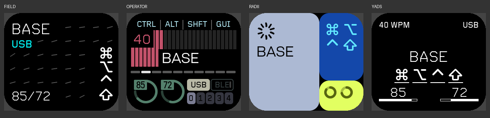
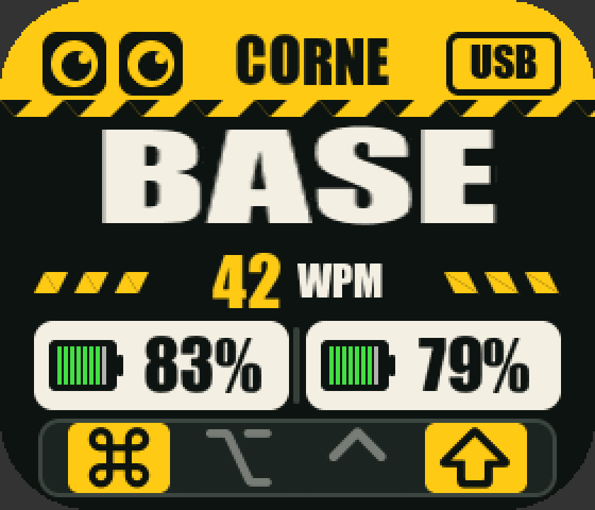

# Corne ms2 Prospector Dongle — DYA + 九主题

**使用与接入：[GUIDE.md](GUIDE.md) · [其他 ZMK 键盘引用 Dongle](docs/OTHER_KEYBOARD_DONGLE.md) · [主题引用](GUIDE.md#主题引用)**

## 仓库内硬件定义

kblade board 和 ms2 配套模块已固定在 [hardware/prospector-zmk-module/](hardware/prospector-zmk-module/)。
两个构建脚本均引用本地目录，west 不再拉取此硬件模块。
板名、引脚、分区保持原样；来源与更新说明见 [hardware/UPSTREAM.md](hardware/UPSTREAM.md)。

目标硬件使用 `kblade//zmk`，Shield 为 `prospector_ms2 corne_dongle`。
保留 ms2 的 ST7789V 接线、280×240 横屏方向、x-offset=20、背光驱动及分区布局，
接入 Prospector Dongle 项目所用的 `cormoran/zmk main+dya` 核心。

## 可引用主题模块

九个主题统一位于 [display-themes/](display-themes/README.md)，包含独立 ZMK 模块入口、
字体、DYA 适配、接入示例和主机测试。原 `themes/` 目录已删除。

## DYA 功能

本分支配置开启：DYA 改键、Custom Settings、Runtime Macro、Runtime Combo、
Runtime Sensor Rotate、Runtime Input Processor、BLE Management、Settings RPC、
Device Info、Devtool 诊断、Battery History、WPM、按键统计及屏幕日志页。

编码器和 Input Processor 服务随固件启用；实际可操作的传感器/输入设备取决于
键盘外设上报及设备树。没有添加不存在的编码器、触摸控制器、RGB 或光线传感器。
Battery History 的副手历史请求需要副手也运行兼容的对应模块。

提供原版 Corne 7 列、46 键、3 层的 DYA 可编辑起始 keymap。没有接收器 RGB
硬件定义，因此原始 keymap 的四个 RGB 动作为 `&none` 占位，其他键位保留。
Runtime Macro 没有自动执行的默认内容；可在 DYA 中创建宏再绑定到按键。
Runtime Sensor Rotate 预定义音量和滚动行为，未虚构物理 sensor。

## DYA 屏幕设置

进入 DYA Studio → Settings → `dongle_display_settings`：

| 设置 | 值与用途 |
| --- | --- |
| `display_theme` | `0` FIELD、`1` OPERATOR、`2` RADII、`3` YADS、`4` INDUSTRIAL、`5` SEGMENT、`6` ORBIT、`7` SPLIT、`8` MONO |
| `display_palette` | `0`–`3`：前三个原版主题的四套配色；YADS 固定黑底白字，INDUSTRIAL 固定黄黑配色 |
| `display_brightness` | `1`–`100`：背光亮度，沿用 ms2 电路的 PWM 反向逻辑 |
| `left_hand_slot` | `0` / `1`：哪一个 split source 是左手，默认 `0` |
| `right_hand_slot` | `0` / `1`：哪一个 split source 是右手，默认 `1` |

点击 **Write** 后由显示线程在下一轮刷新时应用；点击 DYA 的 **Save** 后由
Custom Settings 模块保存，重启后恢复。左右手 slot 应设置为不同值。
不用清除蓝牙绑定来换主题或调换显示上的左右手。

YADS 根据指定的 `zmk-sofle-dongle-dya/4.1-display-themes` 移植：黑底白字，
左上 WPM、右上 USB/BLE，中部保留最近 5 个 HID 英文字母；空闲 5 秒恢复层名。
切层时显示层名与当前层输入字母，快捷键完成后清空字母。修饰键按下时才显示，
从中心展开并各带下划线；底部固定显示左右电量与镜像空心条，无读数显示 `X`。
字母历史仅在 YADS 显示期间存在于 RAM，离开该主题即清空。

## 圆角适配

图纸屏幕为 240×280 像素，有效区 27.972×32.634 mm。ms2 硬件已旋转到
280×240，不再叠加软件旋转。

图纸的多组半径标注不能唯一确定显示 AA 的实际圆角，所以使用保守 **R43 px**
边界并加 **2 px 前景余量**。这是工程检查包络，仍需实际屏幕确认。
FIELD 的文字和右侧修饰键、OPERATOR 的上下信息组、RADII 的层名与电量弧、
以及新增 YADS 的全部信息，都按这个边界检查。独立日志页保持上游布局。

下图是实际 LVGL 主机渲染，套用了圆角查看遮罩，不是实机照片：



[字体与布局边界状态检查图](docs/ms2-font-layout-validation.png)

## 新增 INDUSTRIAL 工业风主题

参考提供的机器人眼睛与黄黑警示纹设计，重新排成 280×240 横屏：金黄顶栏、
机器人眼睛、真实 USB/BLE 输出状态、大层名、32 px WPM 数字及旁置电池电量。
标题仅显示 CORNE；左右电池图标旁使用 32 px 粗体电量，移除 L/R 文字。
底栏为 `⌘ / ⌥ / ⌃ / ⇧` 修饰键状态，左右同类修饰键合并显示；未按下为暗灰，
按下为黄底黑图标。长层名依次选用大、中、小字号，并保持单行。

DYA `display_theme=4` 选择新主题，原有 0–3 的含义保持不变。
该新增主题已完成真实 LVGL 主机渲染和状态检查，固件构建需单独确认后执行。



## 构建

依赖与版本在根目录 `west.yml` 固定。需安装 west、Zephyr SDK，并准备一个
新的 west workspace。示例中仓库目录名为 `zmk-prospector`：

```sh
mkdir ms2-workspace
cd ms2-workspace
git clone -b codex/kblade-dya-four-themes https://github.com/S7venYoung/zmk-prospector.git
west init -l zmk-prospector
west update
west zephyr-export
bash zmk-prospector/scripts/build-ms2-dya.sh "$PWD" --dry-run
# 确认构建后再运行：
bash zmk-prospector/scripts/build-ms2-dya.sh "$PWD"
```

实际构建参数为 `-b kblade//zmk`、`-DSHIELD="prospector_ms2 corne_dongle"`，
同时启用 `studio-rpc-usb-uart` 和 `zmk-usb-logging` 两个 snippet。
它们各自声明独立 CDC ACM 节点，DYA RPC 与串口日志分开传输。
输出位于 `build-ms2-dya/zephyr/`，脚本不刷写设备。

GitHub Actions 工作流只接受 **workflow_dispatch**，提交和 PR 不会触发构建。
依赖从原 kbladewht 核心切换为 DYA 核心，旧固件的 QMK/Vial 扩展不在此配置中。
标准 ZMK 键位和分体行为需要与实际左右手固件完成连通性验证。

## 已完成的检查与边界

- 编译并运行真实 LVGL 与五个渲染器：120 种主题/配色/状态组合，1199 个前景边界，
  圆角越界、父容器裁切、文字框重叠均为 0；另有 50 次前后循环切换的断言检查。
  覆盖长层名、1%/100% 电量、全部修饰键组合，并检查切换配色后层名保持完整。
- 主机模拟 DYA 设置事件：五主题选择、延后到显示线程应用、三主题配色、
  非法主题拒绝、左右手 slot 交换。
- YADS 纯状态机测试：五字母滚动、退格、修饰键清空、快捷键完成、非默认层、
  5 秒空闲、32 位时间回绕和离开主题后的清空。
- 脚本语法与 dry-run 检查。上述主机测试中的设置存储/事件被替身模拟，
  未验证真实串口、DYA Save/NVS、Zephyr 链接、固件 RAM/Flash 占用及实际屏幕。

固件构建状态以对应分支的 Actions 运行结果为准。主机测试不等于固件构建或
实机验收；构建成功后仍需确认 USB/DYA、左右手连接、电量归属、主题即时切换
与断电恢复。构建脚本和工作流不自动刷写设备。

实现与上游版本见 [移植说明](display-themes/README.md)。
