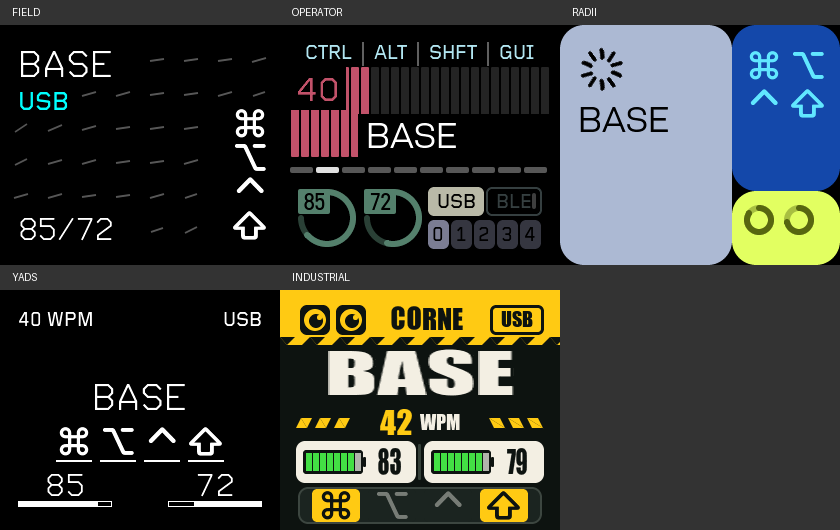

# Prospector Display Themes

可单独引用的五主题 ZMK 模块：FIELD、OPERATOR、RADII、YADS、INDUSTRIAL。
目标画布为 **280×240 横屏**，前景避让 **R43 + 2 px** 圆角安全区。



## 引用方式

仓库分支：`codex/kblade-dya-four-themes`。建议固定到经过验证的提交，避免随分支更新。

将本目录完整复制到自己的项目，或将仓库克隆到 west workspace 外，再在构建命令中加入：

```sh
west build -b kblade//zmk -- \
  -DSHIELD="prospector_ms2 corne_dongle" \
  -DZMK_EXTRA_MODULES="/path/to/prospector-zmk-module;/path/to/zmk-prospector/display-themes"
```

这里的路径需替换为实际绝对路径，并保留自己已有的其他模块。
目录包含独立的 `zephyr/module.yml`、CMake 和 Kconfig；无须复制原仓库的
`config/`、`boards/`、`modules/`、主机应用或构建工作流。
本仓库自己构建时由根 CMake/Kconfig 引用本目录。不要同时加载仓库根模块和
这个子模块，否则会重复注册配置及源码。

通过 west 引入整个仓库时，west 会发现根 `zephyr/module.yml`，根模块已接入此目录，
因此不要再额外添加子目录。最小 manifest 片段见 [examples/west.yml](examples/west.yml)。

## 硬件与版本要求

本模块提供主题、主题切换、DYA 显示设置；屏幕初始化、背光、键盘状态采集、
页面管理和公共 Carrefinho 字体由硬件模块提供。
当前适配的是 `kbladewht/prospector-zmk-module` 的 master：
`37146e417cd95ec95ab144ed9ebb6632da06bd8e`，Shield 为 `prospector_ms2`。
所需接口包括 `prospector_layouts.h`、`fonts_carrefinho.h`、`display_settings.h`、
`s7789_update.h`。本模块替换硬件模块的布局管理器及 FIELD/OPERATOR/RADII 实现，
保留其屏幕、状态桥、字体与日志页。

其他板卡或官方 Prospector 不保证直接可用：需先提供相同状态接口、LVGL 画布和
字体接口，再调整 Kconfig 的 shield 限制及 CMake 的硬件路径。
LVGL 基线为 `zmkfirmware/lvgl@f1db87ee98f1810328a8419572fa42a3b5f352ae`（9.x API）。

## 配置

基础配置见 [examples/ms2/display.conf](examples/ms2/display.conf)：

```conf
CONFIG_ZMK_DISPLAY=y
CONFIG_ZMK_DISPLAY_STATUS_SCREEN_CUSTOM=y
CONFIG_ZMK_PROSPECTOR_SCANNER_ORIGINAL=y
```

不启用 DYA 时，使用硬件模块的主题切换入口：
`prospector_layouts_next()` / `prospector_layouts_prev()`，或在 LVGL 线程调用
`prospector_layouts_set_style()`。布局 ID 为 1 FIELD、2 OPERATOR、3 RADII、
4 YADS、5 INDUSTRIAL；ID 0 CLASSIC 不在本模块内。
硬件模块的默认布局 Kconfig 范围仍为 0–4，因此 INDUSTRIAL 使用运行时 ID 5，
不要将 `CONFIG_PROSPECTOR_DEFAULT_LAYOUT` 设为 5。

### 可选 DYA

需要 `cormoran/zmk` main+dya 和 Custom Settings 模块；本分支固件使用的
核心提交为 `e5c9b6915b56801193e359dd9bad4a167ce0d1b8`。
在现有 Studio / Custom Settings 配置之上启用：

```conf
CONFIG_ZMK_PROSPECTOR_DYA_SETTINGS=y
```

DYA Studio → Settings → `dongle_display_settings`：

| 设置 | 值 |
| --- | --- |
| `display_theme` | 0 FIELD / 1 OPERATOR / 2 RADII / 3 YADS / 4 INDUSTRIAL |
| `display_palette` | 0–3，仅 FIELD/OPERATOR/RADII 使用 |
| `display_brightness` | 1–100，沿用 ms2 PWM 反向逻辑 |
| `left_hand_slot` / `right_hand_slot` | 0 或 1，必须不同 |

Write 应用，Save 持久保存。修改通过 LVGL 定时器应用。
DYA 主题编号为 **0–4**，与内部布局 ID **1–5** 相差 1。
DYA 适配同时通过 split transport 获取左右手电量，未知电量不伪造数值。
YADS 固定黑底白字；INDUSTRIAL 固定黄黑配色，底部为修饰键状态，
电池为长条与窄数字，无百分号。名称 BASE/LOWER/RAISE 可避免长名称回退到小字体。

## 测试与字体生成

```sh
python3 display-themes/tests/host/run.py LVGL_SOURCE MS2_HARDWARE_MODULE OUTPUT_DIR
clang -std=c99 -Wall -Wextra -Werror -I display-themes/src \
  display-themes/tests/host/history_test.c display-themes/src/yads_history.c -o /tmp/yads-history-test
/tmp/yads-history-test
```

从复制出的目录运行时，移除命令中的 `display-themes/` 前缀。
主机检查使用真实 LVGL，覆盖五主题×四配色×六状态、圆角边界、裁切、文字重叠、
主题切换、DYA 设置与修饰键状态。它不代替固件编译和实机验证。
字体生成器为 `scripts/make-industrial-fonts.py`，需 Pillow；源位图随目录提供，
固件构建直接使用预生成 C 文件，不需要 Python/Pillow。

## 来源与验证范围

主题来源、移植记录与上游提交见 [PORTING.md](PORTING.md) 与 [NOTICE.md](NOTICE.md)。
本次抽取前的固件 `ad4ecff` 已完成 GitHub Actions 构建；本次目录重组仅做主机测试
和构建入口路径检查，尚未构建新固件。
